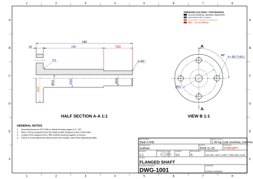
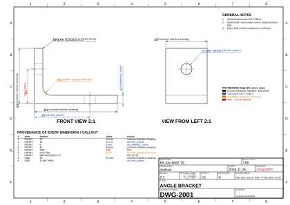

# isodraw

**ISO-style engineering drawings as SVG, straight from your Python calculation scripts — and every number on the sheet says where it came from.**

[](https://github.com/sushkoivan/isodraw/actions/workflows/ci.yml)




*A3 sheet generated by [`examples/flanged_shaft.py`](examples/flanged_shaft.py): half section with hatching, ISO 129-1 half-diameter dimensions, chained lengths, end view, notes, title block — and a mass computed from the very profile that is drawn. Black = sourced, blue = calculated, orange = assumption, red = TBD.*

## Why

Concept drawings usually live in a CAD tool, while the numbers behind them live in spreadsheets and scripts. The two drift apart. `isodraw` lets the script that *computes* a part also *draw* it, so the drawing is regenerated whenever the inputs change — and every dimension is colour-coded by its origin, so a reviewer immediately sees which values are calculated, which are assumed and which are still open.

## Features

- **Pure standard library**, Python ≥ 3.9, zero dependencies, ~1000 lines. Runs anywhere Python runs.
- **Real paper space**: SVG viewBox in millimetres (A4–A0 landscape), so 1 unit = 1 mm when printed at 100 %.
- **Model views at any ISO 5455 scale** (`"1:2"`, `"5:1"`, …): model y up, paper y down, text never mirrored.
- **ISO 128-20 line types**: visible, thin, hidden, centre (chain), phantom.
- **ISO 128-50 section hatching** clipped to any polygon, with angle / spacing / phase for adjacent parts.
- **ISO 129-1 dimensions**: linear (horizontal, vertical, aligned, stacked tiers, text outside when short), diameter, half-section diameter (one arrow across the axis), radius, angle, leaders, item balloons.
- **ISO 5457 frame** with reference zones, **ISO 7200 title block** with ISO 5456-2 first-angle projection symbol, notes blocks with word wrap, detail views with clipping.
- **Provenance colour-coding** of every dimension and callout (see below) plus a machine-readable `sheet.records` register and an optional on-sheet provenance table.
- Geometry helpers: `arc_points`, `polygon_area_centroid`, `revolved_volume` (Pappus) for mass estimates from the drawn profile.

## Install

```bash
pip install git+https://github.com/sushkoivan/isodraw
```

or, for development:

```bash
git clone https://github.com/sushkoivan/isodraw && cd isodraw
pip install -e ".[dev]" && python -m pytest -q
```

## Quickstart

```python
from isodraw import Sheet

sh = Sheet("A4", title="SPACER PLATE", number="DWG-0042", scale="1:1",
           material="EN AW-6082-T6", status="CONCEPT")
v = sh.view(60, 110, "1:1", label="SECTION A-A")       # model origin at paper (60, 110) mm

v.rect(0, 0, 30, 10, hatch=(45, 2.0))                  # cut material, hatched,
v.rect(50, 0, 80, 10, hatch=(45, 2.0))                 # either side of a Ø20 bore
v.centreline(40, -6, 40, 16)

v.dim_linear((0, 10), (80, 10), "customer drawing", offset=12)            # black: sourced
v.dim_linear((30, 10), (50, 10), "calc:bearing_fit", offset=5,             # blue: calculated
             prefix="Ø", suffix=" H7")
v.dim_linear((80, 0), (80, 10), "assume: 10 mm plate stock", orient="v")   # orange: assumption
v.leader(0, 10, "CHAMFER", "TBD", dx=-8, dy=-14)                           # red: still open

sh.notes(25, 140, 70, ["General tolerances ISO 2768-m.", "Deburr all edges."])
sh.prov_legend(150, 18)
sh.save("spacer.svg")

for r in sh.records:                                    # every number, with its origin
    print(r["text"], r["cls"], r["prov"])
```

Try the built-in demo sheet, which exercises every primitive:

```bash
python -m isodraw demo demo.svg
```

## The provenance idea

Every dimension and callout **must** carry a provenance tag — a short free-form string that says where the number came from. The tag is sorted into one of four classes, and the class sets the colour:

| Class | Default rule (case-insensitive, checked in this order) | Example tag | Colour |
|---|---|---|---|
| `tbd` | contains the word `TBD` | `"TBD"`, `"length TBD by supplier"` | red — printed as **TBD**, never as an invented number |
| `assumption` | starts with `assume:` or `A:` | `"assume: 2 mm clearance"` | orange |
| `calc` | starts with `calc:` or `C:` | `"calc:shaft_torsion"` | dark blue |
| `source` | anything else | `"customer drawing rev C"`, `"ISO 273"` | black |

By default the sheet shows only the colours (clean look). With `Sheet(..., show_tags=True)` — *audit mode* — every value also gets a small raised `[tag]`, and `sheet.prov_table(...)` prints the full register on the sheet ([bracket example](docs/img/bracket.svg)). In both modes `sheet.records` holds one dict per number (`n, view, kind, label, value, unit, prov, cls, text`) for export to CSV, a review checklist or a test.

The rules are configurable:

```python
from isodraw import ProvenanceRules, DEFAULT_COLORS, Sheet

rules = ProvenanceRules(
    calc_prefixes=("calc:", "FEA:"),
    assumption_prefixes=("guess:",),
    colors={**DEFAULT_COLORS, "calc": "#006400"},
)
sh = Sheet("A3", provenance=rules)

# or take full control:
sh = Sheet("A3", provenance=ProvenanceRules(classifier=lambda tag: "tbd" if tag.endswith("?") else "source"))
```

## Examples

| | |
|---|---|
| [`examples/flanged_shaft.py`](examples/flanged_shaft.py) — half section, hatching, half-diameter dims, end view with bolt circle, mass from Pappus | [`examples/bracket.py`](examples/bracket.py) — two views at 2:1, hidden lines, fillet, audit mode with on-sheet provenance table |
|  |  |

Demo sheet (`python -m isodraw demo`): [docs/img/demo.svg](docs/img/demo.svg)

## API overview

All lengths in mm. Model coordinates (x right, y up) for `View` methods; paper coordinates (y down) for `Sheet` methods.

| Call | What it does |
|---|---|
| `Sheet(size, title=, number=, rev=, scale=, sheet=, material=, mass=, mass_src=, drawn_by=, date=, status=, owner=, provenance=, show_tags=)` | New sheet `"A4"`…`"A0"` with frame and title block |
| `sh.view(ox, oy, scale, label=, clip=, label_xy=, name=)` | View with model origin at paper `(ox, oy)`; `clip` makes a detail view |
| `v.line / polyline / polygon / rect / circle / arc` | Geometry; `lt` = `visible`, `thin`, `hidden`, `centre`, `phantom`; `hatch=(angle, spacing)` |
| `v.hatch(pts, angle, spacing, phase)` | Section hatching clipped to a polygon |
| `v.centreline(...)`, `v.centre_mark(cx, cy)` | Axes and hole centres |
| `v.dim_linear(p1, p2, prov, offset=, orient="h"\|"v"\|"aligned", tier=, value=, prefix=, suffix=, text_pos=, at=)` | Linear dimension |
| `v.dim_dia_half(x, r, prov, axis_y=)` | One-arrow diameter in a half section |
| `v.dim_diameter(cx, cy, r, prov, ang=)`, `v.dim_radius(...)`, `v.dim_angle(...)` | Diameter, radius, angle |
| `v.leader(x, y, text, prov, dx=, dy=)`, `v.balloon(x, y, n, prov)` | Callouts and item balloons |
| `sh.text(x, y, s, h=)`, `sh.notes(x, y, width, items)`, `sh.banner()` | Paper-space text, notes block, watermark |
| `sh.prov_legend(x, y)`, `sh.prov_table(x, y, width, max_h=)` | Colour legend, full provenance register |
| `sh.records`, `sh.to_svg()`, `sh.save(path)` | Register of every number, SVG output |
| `arc_points`, `polygon_area_centroid`, `revolved_volume`, `parse_scale`, `fmt_value` | Helpers |

Every dimension method returns its record dict, and accepts `value=` to print a nominal value instead of the measured geometry.

## Standards covered (simplified)

ISO 128-20 (line types) · ISO 128-50 (section hatching) · ISO 129-1 (dimensioning) · ISO 3098 (lettering heights 2.5 / 3.5 / 5 / 7 mm) · ISO 5455 (scales) · ISO 5456-2 (first-angle projection symbol) · ISO 5457 (sheet sizes, frame, reference zones) · ISO 7200 (title block).

## Limitations

- It is a **drawing** library, not a CAD kernel: you place every view and dimension yourself; there is no 3D model, projection or hidden-line removal.
- Text widths are estimated from Arial metrics, so layout is approximate; viewers without Arial/Helvetica fall back to another sans-serif.
- No automatic collision avoidance between dimensions — use `offset`, `tier`, `text_pos` and `at` to arrange them.
- Output is SVG only. For PDF, print the SVG from a browser or use Inkscape / `cairosvg`.
- Only first-angle projection is drawn in the title block; tolerances, surface finish and weld symbols are written as text.
- The standards are followed in spirit for concept and review drawings; check them against your organisation's drawing rules before using sheets for manufacture.

## Origin

Born while generating concept drawings straight from calculation scripts for a student rocketry project.

## License

[MIT](LICENSE)
